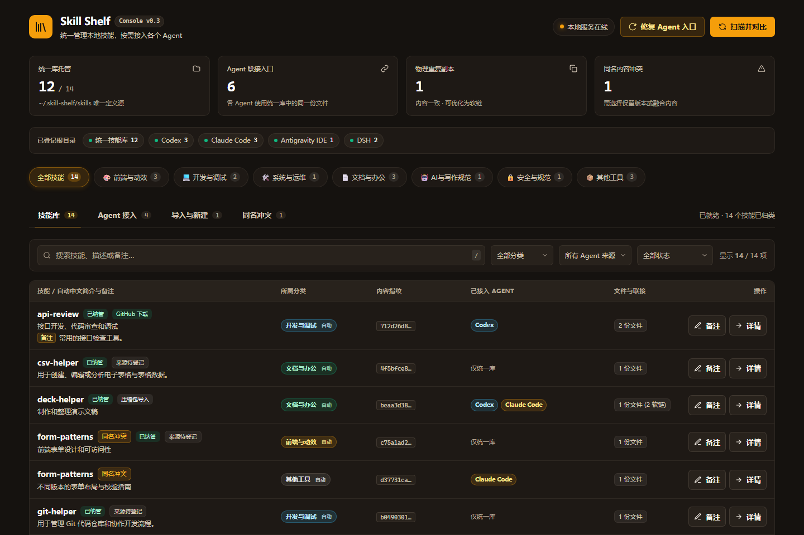

# Skill Shelf

Skill Shelf 是面向 Windows 的本地 Agent Skill 管理工具。它把 Codex、Claude Code、Antigravity IDE 和 DSH 中的技能放在一个统一库里管理，并通过目录联接让各 Agent 使用同一份文件。



## 功能

- 扫描多个 Agent 技能目录，按完整内容哈希去重，并列出同名不同内容的冲突。
- 将技能导入统一库，支持 Git 仓库、本地 ZIP 或 `.skill` 压缩包，以及本地新建。
- 记录 GitHub 来源、检查远端更新；发现本地改写时阻止自动覆盖。
- 设置分类和备注，按技能名、中文简介和用途搜索。
- 把统一库技能接入各 Agent 目录；可自动为新增技能补建目录联接。
- 删除技能或整理重复副本时，将确认后的物理目录移入 Windows 回收站；目录联接不会当作物理副本删除。

## 获取代码

```powershell
git clone https://github.com/skdfndh/better-skill-manager.git
Set-Location better-skill-manager
```

## 运行

需要 Windows 10/11 和 Python 3.10 或更新版本。首次使用时，在项目根目录复制一份通用配置：

```powershell
Copy-Item roots.example.json roots.json
```

如需自定义目录，可编辑 `roots.json`。然后选择一种运行方式。

### 本地端口版

```powershell
.\start.ps1
```

浏览器访问 http://127.0.0.1:8765。服务只绑定本机回环地址，不向局域网开放；此模式使用 Python 标准库，不需要安装第三方 Python 包。

### 桌面版

开发运行：

```powershell
.\start-app.ps1
```

首次运行会创建 `.venv-desktop` 并安装 PyWebView。打包为独立程序：

```powershell
.\build-app.ps1
```

程序生成在 `dist/SkillShelf.exe`，构建脚本还会在桌面创建或更新快捷方式。桌面版需要 Microsoft Edge WebView2 Runtime；缺少时请安装 [WebView2 Evergreen Runtime](https://developer.microsoft.com/microsoft-edge/webview2/)。

## 配置与数据

- `roots.example.json` 是不含个人冲突选择的通用配置。首次运行前复制为被 Git 忽略的 `roots.json`。
- 统一技能库默认位于 `%USERPROFILE%\.skill-shelf\skills`。可在配置的 `library_path` 中修改。
- 源码模式的扫描缓存、备注、来源记录和操作结果保存在项目目录中；桌面程序将这些数据保存在 `%LOCALAPPDATA%\SkillShelf`。
- 应用会管理用户配置中登记的技能目录。首次部署或启用自动接入前，请先检查 `roots.json` 中的路径和选项。

## 安全与行为

- 扫描技能时只读取文件，不执行 Skill 内的脚本。
- Git 与压缩包导入先预览再确认；压缩包导入会拒绝路径穿越和符号链接。
- 同名但内容不同的技能不会自动覆盖或融合。冲突需要用户选择保留版本或逐文件融合。
- 导入、更新和部署会校验内容；删除及清理会先检查目标，并将物理目录移入 Windows 回收站。
- 前端通过本机 HTTP API 与服务通信。后端 API 可供后续前端界面复用。

## 开发与持续集成

依赖清单为 `requirements-app.txt` 和 `requirements-desktop.txt`。贡献方式见 [CONTRIBUTING.md](CONTRIBUTING.md)。GitHub Actions 会在 Windows 环境检查 Python 语法并打包桌面程序，生成的 EXE 作为短期构建产物提供下载。另外提供使用合成隔离数据的界面回归脚本，以及技能整合的文件与路由检查；复现方法和验证边界见下方实验记录。

## 技能整合与验证记录

- [UI 设计技能评价与整合方案](docs/skill-evaluation-and-ui-integration.md)：25 个原始入口的初评、专长关系和 20 条路由对照。
- [界面优化与实测记录](docs/ui-design-real-world-evaluation.md)：前后截图、22 项浏览器回归、9 项原生桌面检查及未验证范围。
- [ui-design](skills/ui-design/SKILL.md)：按任务分派的 UI 总入口，[emil-frontend](skills/emil-frontend/SKILL.md) 保留旧名称兼容；24 个第三方专长需另外安装，本仓库不包含其全文。
- [skill-curator](skills/skill-curator/SKILL.md)：复用本次技能评价、整理、入口整合与实测的方法，包含评分口径及验证指导。

`skills/` 保存自有入口源文件，不会随管理器启动自动安装。使用时按各 Agent 的技能目录约定安装相应文件夹；统一库的安装和联接可由 Skill Shelf 管理。UI 优化没有给前端新增评分面板。

## 许可证

本项目采用 [MIT License](LICENSE)。Copyright (c) 2026 Skill Shelf contributors。
