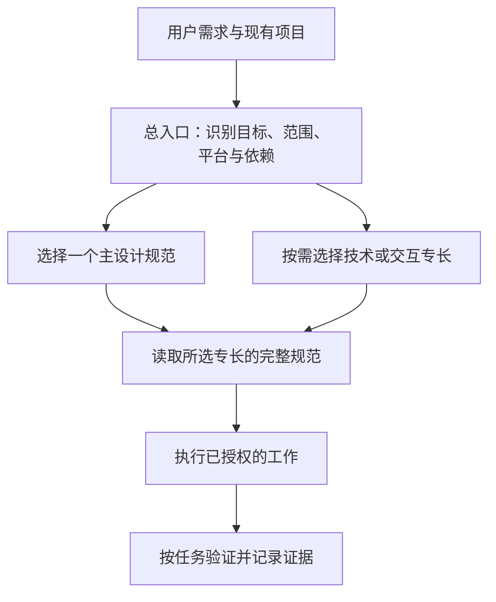

# Skill 评价与专长整合：UI 设计实验

方案与实验记录。开始日期：2026-10-27；本轮整理日期：2026-10-28。

## 想法与目标

给现有 Skill 提供有依据的多维评价，帮助判断何时使用、是否完整、与哪些 Skill 重复或互补。对同领域 Skill 建立一个总入口，详细介绍专长并根据真实任务按需调用，减少用户选择成本和重复加载。

用户已选择的结构是：**一个总入口，多个独立专长**。总入口保存任务识别、分派、组合及冲突处理规则；专长保留完整规范、脚本和参考资料。相似度用来提示复核，分数用来解释可用性，都不直接触发删除、替换或合并。



例如：“调整后台表单间距”选择 Impeccable layout；“现有 Next.js 与 GSAP 的滚动交互”选择 React 生命周期、ScrollTrigger，并在需要时补 core。不同 Agent 可以通过自己的 Skill 工具或直接读取 `SKILL.md` 完成交接，不依赖一个固定的 Skill 调用 API。

入口本身是供 Agent 使用的指令。它没有创建一个后台调度服务，也不等于自动启动多个独立 Agent。总入口被加载后的选择流程可以验证；宿主是否自动选中这个入口仍取决于各 Agent 的发现和触发机制。显式使用 `$ui-design` 可以明确进入本流程。保留独立专长时，不承诺所有隐式 UI 请求都必经总入口。

## 评价办法

评价需要保留版本、来源、证据与不确定性。任何评分都必须绑定被评文件的内容哈希；文件变化后，旧评分作为历史记录，并提示复评。

将可验证的事实与判断分开记录：名称、引用文件存在性、脚本、依赖和触发政策属于事实；指令清晰度与流程合理性是静态判断；真实任务成功率、视觉质量、耗时与成本要通过行为实验获得。没有运行的维度标记“未验证”，不填一个猜测的成功分。

本轮采用静态初评，六项合计 100 分：

| 维度 | 满分 | 判断依据 |
|---|---:|---|
| 触发边界 | 20 | 用途是否明确，能否区分邻近任务，是否保留显式调用政策 |
| 流程可执行性 | 20 | 是否给出可执行的步骤、输入、输出及合理的失败处理 |
| 支撑资源 | 15 | 所需参考、脚本和示例是否存在，关键内容是否自包含 |
| 约束与安全 | 15 | 是否控制修改范围、只读边界、副作用和无根据的承诺 |
| 兼容性 | 15 | 平台、版本、路径、已有依赖和设计系统的处理是否合理 |
| 维护与精简 | 15 | 重复、矛盾、过长入口、版本敏感内容及更新边界 |

自包含的 Markdown Skill 不因没有脚本而扣分。分数是约有正负 5 分判断误差的初评，置信度为中。窄职责 Skill 与通用设计 Skill 的难度不同，不能仅凭总分跨领域排名、删除较低分项或认定其没有价值。

后续真实任务评价可分别记录任务达成、触发命中/误触发、回归、用户视觉评价和上下文成本。在积累可比较的行为数据后，再决定它们与静态分的权重。

## 本轮范围与评分

检查了统一库中的 25 个现有入口：1 个旧路由入口和 24 个专长。逐个读取 `SKILL.md`，复核相关引用、依赖、触发限制和关键示例。长参考与脚本按相关分支抽查，没有对全部脚本逐行审计。没有执行 UI 构建、浏览器视觉评测、原生编译或联网核实第三方 API 和授权。

下表维度顺序为“触发 / 流程 / 资源 / 约束 / 兼容 / 维护”。`emil-frontend` 的分数针对改造前的原文，原文哈希和快照已经保留。

| Skill | 六项分数 | 总分 | 整理决定 |
|---|---|---:|---|
| impeccable | 17 / 19 / 15 / 12 / 11 / 10 | 84 | 产品 UI、审查和精修主力，按子命令加载 |
| frontend-design | 16 / 14 / 14 / 10 / 13 / 14 | 81 | 新品牌视觉主力，保留已有品牌优先级 |
| design-taste-frontend | 19 / 18 / 9 / 12 / 12 / 9 | 79 | 保留显式调用；缺失资源的场景分支停用 |
| landing-page-generator | 17 / 16 / 11 / 10 / 13 / 11 | 78 | 专注转化结构；未证实数字不作为业务事实 |
| emil-frontend（原版） | 15 / 13 / 15 / 11 / 9 / 12 | 75 | 留快照，改成新总入口的兼容转接 |
| emil-design-eng | 13 / 16 / 15 / 11 / 11 / 7 | 73 | 保留为按主题查询的设计理念参考 |
| apple-design | 17 / 17 / 15 / 13 / 11 / 10 | 83 | 仅在选定风格或相应交互需求时加载 |
| animate | 18 / 18 / 15 / 12 / 12 / 12 | 87 | Web 动效实施，沿用既有库与 token |
| animate-expo | 19 / 18 / 15 / 13 / 10 / 11 | 86 | RN/Expo 平台专长，核对实际 SDK |
| animation-vocabulary | 20 / 18 / 15 / 14 / 12 / 12 | 91 | 保持术语查询短路径，不扩展到实施 |
| ask-sonner | 20 / 19 / 15 / 14 / 12 / 13 | 93 | 已选 Sonner 的组件实施与故障排查 |
| find-animation-opportunities | 19 / 17 / 15 / 14 / 12 / 11 | 88 | 保留只读机会发现角色 |
| improve-animations | 19 / 18 / 15 / 10 / 13 / 12 | 87 | 保留全库审计和计划，实施单独分派 |
| review-animations | 16 / 16 / 15 / 10 / 11 / 12 | 80 | 保留显式审阅政策，审美判断需要证据 |
| pick-ui-library | 19 / 17 / 15 / 13 / 10 / 12 | 86 | 保留显式选库，尊重框架与现有选择 |
| prototype | 19 / 19 / 15 / 13 / 13 / 12 | 91 | 保留显式多方案流程，等待用户选定 |
| write-swift | 19 / 18 / 14 / 13 / 9 / 8 | 81 | Swift 平台技术附属；纯语言任务直接处理 |
| gsap-core | 16 / 18 / 14 / 13 / 13 / 13 | 87 | 已选 GSAP 的基础与响应式参考 |
| gsap-react | 17 / 18 / 14 / 13 / 13 / 13 | 88 | React 生命周期和作用域专长 |
| gsap-frameworks | 17 / 12 / 9 / 13 / 12 / 10 | 73 | 保留；修复示例缺口前不直接复制 |
| gsap-timeline | 18 / 18 / 14 / 12 / 14 / 14 | 90 | 多步编排才加载，避免并入 core 全文 |
| gsap-scrolltrigger | 16 / 12 / 12 / 11 / 12 / 10 | 73 | 保留；横向滚动示例需要修复 |
| gsap-plugins | 17 / 16 / 13 / 12 / 11 / 10 | 79 | 按具体插件章节加载并核对版本 |
| gsap-performance | 16 / 16 / 13 / 11 / 13 / 14 | 83 | 先测量，再处理已定位的 GSAP 瓶颈 |
| gsap-utils | 18 / 14 / 13 / 12 / 12 / 12 | 81 | 按函数查询，疑似错误示例先核验 |

可复核数据见 [evaluation.json](../experiments/ui-design/evaluation.json)，包含各维分数、入口 SHA-256、包清单哈希、行数和文件数。包哈希忽略 `.git`、`node_modules`、`__pycache__`。后续应以任务内比较为主，不用总分抹平不同角色的价值。

## 具体发现与建议

证据路径相对统一库，行号对应本轮原版快照。来源更新后以内容哈希判断是否仍适用。

| 对象 | 可复核证据 | 处理建议 |
|---|---|---|
| 旧 emil-frontend | `emil-frontend/SKILL.md:33` 的 12 个子技能在；`:51` 的回退路径固定为个人目录 | 扩展覆盖范围、使用相邻目录寻址；旧名改为单向转接 |
| Impeccable | 入口 28 个本地 Markdown 引用存在；`reference/product.md:13` 区分产品界面；`scripts/context.mjs:763` 联网检查版本，`:815` 写缓存 | 保留主力角色；用户严格只读时避开缓存、快照和报告写入；管理功能按实际授权 |
| frontend-design 与多套审美 | `frontend-design/SKILL.md:30` 禁止常见字体，`:35` 鼓励装饰；Impeccable 和 Apple 又有不同字体、弹簧、材质规则 | 每次只选一个主视觉规范；现有品牌、用户指定风格与可访问性优先 |
| Taste 本地包不完整 | `design-taste-frontend/SKILL.md:271` 引用场景资产；实际没有 `library/scenes.json`、具体 scene 与 demo；`:3` 及 UI 元数据要求显式使用 | 保留可用的普通页面/app 流程；禁用缺资源的 scroll-scene 分支，保留显式政策 |
| 落地页参考 | `landing-page-generator/SKILL.md:37` 等处有无出处的精确转化数字；推荐的 6 个营销关联 Skill 未安装 | 保留核心内容结构，不转发缺失依赖，不把参考数字当作客户事实 |
| Emil 理念与通用动效 | `emil-design-eng/SKILL.md:8` 有固定英文答复，正文约 675 行；`animate/SKILL.md:73` 建议隐式选库，`:121` 的时长例外与后文上限有张力 | 理念按主题读取；保留用户语言、既有库与 token，不固定加载全部指南 |
| 显式调用边界 | Taste、pick-ui-library、prototype、review-animations 均有显式限制；后者 `SKILL.md:4` 为 `disable-model-invocation: true` | 总入口不把自身被调用解释成所有专长都已获显式授权 |
| 审计与实施 | `improve-animations/SKILL.md:22` 限制只读，`:96` 又有 execute 分支；机会发现明确只读 | 先按用户范围定模式，审计请求止于报告；授权实施后转实施专长 |
| GSAP 非 React 示例 | `gsap-frameworks/SKILL.md:23、94` 引用的 examples 不存在；`:130、161` 同一代码块重复定义 `type Plugins` | 采用最小生命周期模式，不复制完整 Nuxt 示例；后续修复缺资源和重复类型 |
| ScrollTrigger 横向示例 | `gsap-scrolltrigger/SKILL.md:235` 有未定义 `Max.max`、像素量给 `xPercent`、位移方向问题；`:228` 提及 scrub 但示例缺配置；`:265` 全局 kill | 入口登记已知问题；实际实现检查单位、方向和绑定；组件只清理自身资源 |
| GSAP 工具及版本声明 | `gsap-utils/SKILL.md:194` 的 unitize 值/函数示例、`:130` 的 shuffle 是否原地修改有疑点；plugins 有版本与授权声明 | 实际使用这些 API、安装插件或给授权建议前查现行官方资料；本轮未核验这些外部事实 |
| 平台边界 | animate-expo 假定较新 Reanimated/SDK；write-swift 主要为语言及并发知识 | 先识别工具链，不把 Apple 风格等同于 Swift，不为套用示例升级项目 |

这轮先处理分派和冲突规则，24 个专长的原始文件保持可独立更新。缺陷已写入新入口的专长目录，后续可逐个修复并重新评价。修复第三方内容时继续保留来源与差异，避免更新时静默覆盖本地改造。

## 整合产物

- [ui-design/SKILL.md](../skills/ui-design/SKILL.md)：总入口、任务矩阵、GSAP 按需分派、交接与范围控制。
- [specialists.md](../skills/ui-design/references/specialists.md)：24 个专长的职责、调用条件、输入资源、交付类型及已知限制。
- [openai.yaml](../skills/ui-design/agents/openai.yaml)：中文显示名称和调用示例，保留默认自动发现。
- [emil-frontend/SKILL.md](../skills/emil-frontend/SKILL.md)：兼容旧名称，单向转入总入口，不再重复保存总览规范。

仓库 `skills/` 保存可审阅、可版本管理的本地整合源文件；安装副本存放在统一库 `%USERPROFILE%/.skill-shelf/skills/`。没有复制第三方专长的全文或脚本到公开项目。它们仍是本地依赖，实际调用前检查是否安装；本仓库不是包含所有依赖的独立技能包。

原 `emil-frontend/SKILL.md` 在项目被 Git 忽略的 `backups/ui-design-20261028/emil-frontend/` 下留有原文快照。评分文件保存原文哈希。恢复时应先确认现有文件没有后续改动，再把快照作为一个新版本恢复；不要用 Git 历史重写替代恢复。

2026-10-28 已完成本地安装：新总入口与兼容入口在统一库中各有一份物理内容，Codex、Claude Code、Antigravity IDE 和 DSH 的已配置部署目录均通过 Junction 使用它们，共核对 8 个入口联接。管理器源码版和桌面版的数据目录均已补充这两个入口的本地来源、分类、备注和受管理联接记录，并重新扫描；没有同名冲突，扫描错误为 0。具体结果见 [deployment.json](../experiments/ui-design/deployment.json)。

专长包完整性检查确认其余 24 个包未变化。兼容源目录仍按原配置管理，本轮新入口以 `deploy_targets` 的四个 Agent 为部署范围。入口安装阶段没有修改应用源码或重构建 EXE；后续实际应用的界面优化与桌面重打包见文末记录。旧会话是否立即刷新可用 Skill 列表由宿主决定，显式引用新入口路径可用于检查。

调用示例：

```text
$ui-design 检查这个后台界面的布局和可用性，先给建议。
$ui-design 使用现有 Motion 为弹窗改善中断与退出行为。
$ui-design 项目已经有 GSAP，按 React 生命周期实现滚动进度交互。
```

## 路由实验与结果

把同一组 20 个用户请求分别交给两个独立、未继承父任务讨论的评估者。一个读取原 `emil-frontend` 快照，一个读取新入口和实际相邻专长。评估者只做路由推演，可读必要规范，禁止修改、运行子技能脚本、联网或读取预期答案。

检查包含产品布局、品牌页、转化结构、单/多方案原型、Taste 显式限制、术语查询、只读全库审计、机会发现、Sonner、CSS、React/Nuxt GSAP、Expo、纯 Swift、后端负例和 Motion 保留。预先固定的检查条件为：必要专长、可接受主专长、禁止误选项、子命令和只读/实施/领域边界，并限制一次过量加载。

| 指标 | 旧入口 | 新入口 |
|---|---:|---:|
| 满足用例预设路由条件 | 12/20 | 20/20 |
| 测试请求数 | 20 | 20 |
| 实际生成并验证 UI 作品 | 未进行 | 未进行 |

旧入口的 8 个缺口为产品布局、品牌页、转化落地页、单方案原型、产品体验评价、React GSAP 滚动、Nuxt GSAP 生命周期和普通弹窗技术审查。已有术语、Sonner、Expo 和动效审计路径仍然有效。新入口同时指出 Taste 和 Nuxt 的可选示例资源缺失，并保留可运行的其他路径。

这是小样本、单轮的路由选择实验，不能解释为真实任务成功率 100%、优于所有模型、没有误触发，或真实视觉质量已经提升。测试明确给入口后进行分派，没有验证各宿主从可用技能列表中自动选中入口的概率。没有取得可复核的 token/耗时统计，不作成本结论。测试输出的 `mode` 是范围判断，没有真实执行只读/写入流程。

测试数据：[routing-cases.json](../experiments/ui-design/routing-cases.json)。两个评估者的选择、模式、缺依赖信息与缩写理由：[routing-results.json](../experiments/ui-design/routing-results.json)。原始回答保留于本任务的评估记录中，持久化 JSON 的理由做了缩写。

可重跑的文件、评分和部署检查：

```powershell
python -X utf8 .\experiments\ui-design\validate_integration.py --config .\roots.json
```

这个检查验证分数总和、原始专长包哈希、源文件与安装副本一致性、真实 Markdown 引用、专长覆盖、已配置 Agent 的联接，以及保存的路由输出是否符合固定条件。它重新评分既有输出，不重新调用模型；要再次测模型，应重新产生独立输出后再运行。专长更新导致哈希变化时，停止通过并提示复评，避免把旧评分套到新版本。

本轮结构校验均通过，52 处本地 Markdown 引用均可解析。独立入口复核没有发现阻塞问题，并据复核意见统一了 critique/audit 的区分及严格只读的副作用处理。文件与路由检查结果保存在 [verification.json](../experiments/ui-design/verification.json)。

## 验证边界与安全检查

新入口及兼容入口是纯 Markdown/YAML，不包含运行脚本。结构与命名使用 skill-creator 的 quick_validate 校验；还检查了本地引用、目录联接、专长文件未意外变化和常见凭据形态。

skill-vetter 的依赖检查原样报告：`Missing dependencies: aguara skill-scanner jq`，退出码为 1。因此没有运行完整的四扫描器流程，也不报告“全部安全扫描通过”。未安装这些额外工具。本轮完成的是结构、引用、常见凭据形态和人工范围检查，无法排除所有安全问题。所依赖的既有专长脚本未被执行或授予额外权限。

Skill 调用可能涉及原专长自己的依赖和副作用：例如 Impeccable 更新缓存、Taste 素材下载和浏览器检测、原型产物写入。入口要求与用户范围相符并先检查必要脚本，严格只读时避开写入路径。缺少浏览器、设备或 SDK 时明确标注未验证。

## 管理工具后续如何接入

本轮交付文档、可追溯的评价数据和可使用的 UI 入口。Skill Shelf 的桌面前端及后端接口没有新增评分功能。后续产品化可复用当前数据模型：

1. 单个 Skill 展示静态分项、证据、置信度、内容哈希及“需复评”状态；实际任务分单独展示。
2. 技能家族展示入口、专长、兼容名称和关系类型，区分重复、互补、冲突和平台附属。
3. 整理前显示改动预览、来源和已知缺陷；生成草稿，完成引用与路由检查后，再由用户决定替换或全局部署。
4. 保留各专长的独立更新，检测上游变化时提示入口目录和评价复核。删除入口、删除专长和删除别名应分别说明影响；入口不自动删除被引用专长。
5. 之后选取少量真实界面任务，比较生成效果、回归与上下文成本，再决定是否精简重复正文或推广到 PDF、PPT 等其他家族。

## 第一次实际应用

2026-10-28 已将新入口用于 Skill Shelf 本身的界面检查与优化，完成真实后端隔离测试和桌面打包。前后截图、工程评分、首轮失败及最终 22 项浏览器回归与 9 项原生桌面验证结果见 [ui-design 实际应用记录](ui-design-real-world-evaluation.md)。该结果证明本次端到端流程可以执行，不替代后续跨任务或有/无入口对照实验。

## 经验技能

本轮方法整理为 [skill-curator](../skills/skill-curator/SKILL.md)，用于已有 Skill 的有证据评价、关系分析、总入口整合和真实任务验证。它把静态分、路由实验、实际产出与原生宿主验证分开，保留显式调用政策、独立来源与更新、版本变化需复评，以及合成数据和发布边界。详细口径和验证方法按需加载，不复制 UI 专长全文，也不将本次 UI 的具体 CSS 固化为通用要求。

该技能为纯 Markdown/YAML；结构与本地引用检查不等同于完整安全扫描，也尚未在第二个技能家族上进行独立行为评测。使用示例：`$skill-curator 评估现有文档处理技能，先给关系和评分证据，再按我确认的范围整合。`
