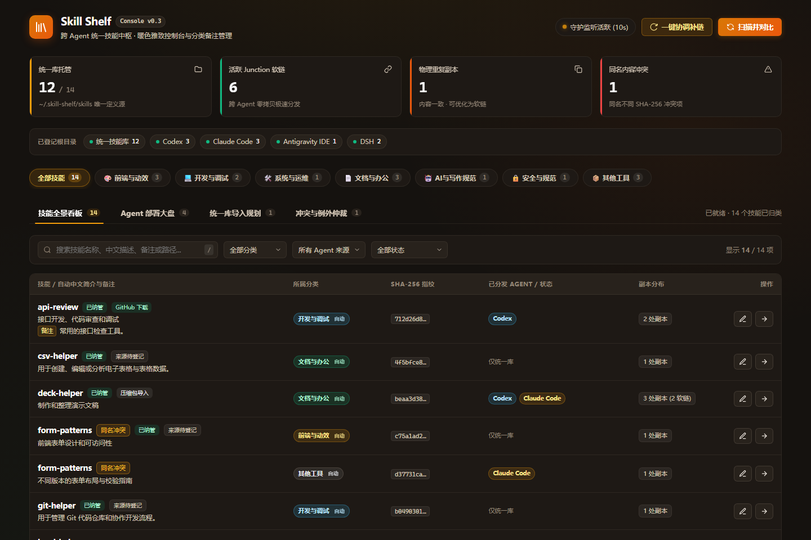
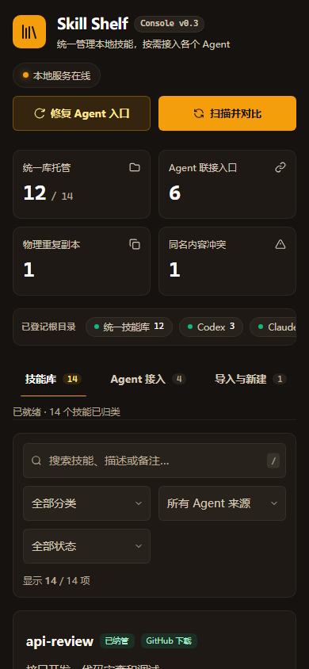

# ui-design 实际应用：Skill Shelf 界面检查与优化

日期：2026-10-28。目标：现有 `index.html` 与其本地 API，保持原生 HTML/CSS/JavaScript、暖色深色主题和当前主要工作流。

## 本轮结果

使用新的 ui-design 总入口完成了真实应用的检查、修复、浏览器验证和桌面重新打包与原生 WebView2 验证。工程审阅分从 **8/20 调整为 15/20**；最终 **22/22 项浏览器回归检查通过**。这两种结果含义不同：分数是本轮有证据的人工工程判断，22 项检查是明确条件下的操作验证，均不代表完整可访问性认证或所有场景无缺陷。

主要改动包括键盘分类、筛选清除、抽屉和嵌套确认的焦点管理、小屏布局、表单标签、主按钮对比度及准确的状态反馈。还修复了新建后界面报错、同名外部版本误删统一库内容的风险，以及旧异步回调关闭新弹窗的问题。

## 总入口实际如何选择专长

任务是已有产品工具的界面评估与改进，ui-design 选择 **Impeccable 的 product register**，先做 `audit` 技术检查，再使用 `polish` 完成已获授权的修复与精修。没有套用新品牌页面的字体和装饰规则；已有系统字体、HTML 技术栈与暖色主题继续作为设计依据。

只加载该任务所需的规范。页面的 toast 为自实现，不因源码中的 Sonner 注释而自动引入 Sonner。现有过渡可由 CSS 完成，没有引入 GSAP、其他动画库、Taste 或多方案原型流程。缺少 PRODUCT.md 没有阻断对已有工具的局部改进，也没有顺带生成产品需求文件或全局配置。

流程使用真实源码和真实后端，但所有业务写入都指向合成技能的隔离目录。fixture 明确禁止后台自动联接到真实库；测试脚本也检查所有配置根目录都位于实验创建的备份目录。没有删除、导入或改写用户的真实 Skill。

这证明该入口能够在一个实际任务中选择合适规范、保持技术和品牌约束、推进到可运行交付。没有进行同模型“有入口/无入口”的完整 UI 实施对照，因此不把这次结果解读为整合导致设计质量提升的因果证明。

## 优化前后

截图使用同一组合成数据的初始状态，含 14 个内容版本、12 个统一库技能和一组同名冲突；在业务测试修改合成数据前拍摄。

优化前：



优化后：


390px 视口：



| 实测项目 | 优化前 | 优化后 |
|---|---:|---:|
| 390px 视口的文档宽度 | 547px，存在裁切 | 390px |
| 缺少可访问名称的表单控件 | 14 | 0 |
| 原生分类按钮 | 0，使用不可聚焦的 div | 8，支持 Enter/Space 与选中状态 |
| 通用确认面板的 dialog 角色 | 缺失 | 已提供 |
| 主按钮文字对比度 | 渐变端点最低约 3.19:1 | 约 8.69:1 |
| 扫描/监听文案 | 无依据地显示“守护监听活跃” | 根据连接结果显示服务状态与失败恢复提示 |

移动视口的重复分类栏隐藏，使用已存在的分类下拉；筛选区独占整行，统计另起一行。目录表格转换为可读的条目布局，其他数据表在自身容器内滚动。桌面增加可辨识的“备注”和“详情”文字入口；内容指纹仍可查看和复制。

## 工程审阅分

按 Impeccable audit 的五个维度各 0–4 分记录，重点评价可核实实现。评分不等同于自动测试结果。

| 维度 | 优化前 | 优化后 | 依据与保留限制 |
|---|---:|---:|---|
| 可访问性 | 1 | 3 | 控件命名、按钮语义、焦点循环/恢复、标签页方向键和 reduced-motion 已检查；未做真实读屏用户测试 |
| 性能 | 3 | 3 | 继续使用原生实现，无新增运行依赖，去掉装饰性背景和在线脉冲；未做大量技能压力测试或 FPS 测量 |
| 响应式 | 0 | 3 | 5 个视口、4 个工作区共 20 个组合无页面横向溢出；未在实体手机上测试 |
| 主题一致性 | 2 | 3 | 保留现有主题，改善主按钮、弱文字与焦点；源码仍有历史局部颜色值 |
| 信息与视觉反模式 | 2 | 3 | 减少装饰、技术术语和无依据承诺，区分物理文件与联接；多种标签仍有进一步精简空间 |
| **合计** | **8/20** | **15/20** | 分数为本轮工程判断，非通用排名 |

## 已处理的问题及证据

| 优先级 | 问题 | 实施结果 |
|---|---|---|
| P1 | 手机页面主区域溢出，表头纵向挤压、操作被裁切 | 重排页头、导航、筛选和条目；320/390/768/1024/1440px 逐个检查 |
| P1 | 分类依赖点击，表单无名称，弹窗可把焦点送到背景 | 原生按钮、标签与 ARIA、焦点边界、背景 inert、嵌套层级及返回焦点 |
| P1 | 同名冲突的外部版本详情也可点击删除，后端按名称删除统一库中的另一版本 | 仅统一库版本开放删除/重新部署；确认中展示实际目录和指纹，请求传目录及 expected_hash；后端在移除联接和回收前校验指纹 |
| P1 | 新建后端成功，表单异步回调仍使用已失效的 event.currentTarget | 提前保存 form 引用，创建成功后正确重置，避免把成功操作报成失败 |
| P2 | 旧确认请求结束会关闭用户随后打开的新弹窗 | 用会话标识隔离回调，处理中明确“关闭窗口不会中断操作” |
| P2 | 轮询恢复后在线状态与失败提示并存 | 有失败提示或扫描变化时完整重读并返回，状态保持一致 |
| P2 | 部署成功数量读取不存在的 applied_links | 按后端 linked、already_linked、failed 显示实际结果 |
| P2 | 联接位置也被称为物理“副本”，误导清理判断 | 显示真实物理文件数，联接数单独注明 |
| P2 | 自定义备注宣称云端同步，初始状态宣称后台监听 | 改为仅保存在本机与本地服务在线，增加持久失败提示和重新连接入口 |
| P2 | 无结果只能手动逐个恢复筛选，复制未确认成功就提示完成 | 增加清除筛选及恢复指引；等待剪贴板写入成功，失败给出可操作说明 |

后端的 expected_hash 参数可选，保留既有调用兼容性；本版前端删除请求总是发送所选版本指纹。本轮验证了错误指纹返回 409 且源文件仍在，没有执行真实回收站删除。此检查用于防止确认前已变化的内容被错误处理，不承诺阻止应用之外的所有文件系统竞争。

## 验证记录

第一轮通过 **15/17**，原始失败保存在 [app-ui-results-initial.json](../experiments/ui-design/app-ui-results-initial.json)：

```text
FAIL 本地创建使用真实隔离后端: page.waitForFunction: Timeout 10000ms exceeded.
FAIL 压缩包预览、选择与导入: locator.click: Timeout 10000ms exceeded.
```

第一项定位到上述表单真实缺陷；第二项是测试在前项失败复位后没有自行切换到导入页，修复了用例前置条件。独立复核又指出删除版本歧义、手机筛选宽度、轮询恢复和异步弹窗四项问题，逐项修复并增加防回归检查。新一轮使用全新隔离数据，**22/22 通过**，包含：

- 分类、搜索、清除、来源/Agent 筛选和标签页方向键。
- 抽屉焦点循环、嵌套确认、Escape 返回和显式危险操作确认。
- 真实 API 的备注与分类保存，备注中的 HTML 作为文本显示。
- 外部同名版本禁删，后端错误指纹拒删，冲突方案预览可取消。
- 真实部署结果数量一致，真实本地创建、压缩包预览和导入。
- 5 个视口与 4 个工作区的布局，以及主要移动触控尺寸。
- reduced-motion、失败重试、扫描时间不变时的轮询恢复和无未处理页面异常。
- 用受控 API 响应单独验证旧异步回调不会关闭新弹窗；此项未执行第二次真实部署。
- 关闭抽屉从焦点与辅助技术树中移除，标签分类栏不产生竖向滚动。

详细结果：[app-ui-results.json](../experiments/ui-design/app-ui-results.json)。可复现工具为 [serve_app_fixture.py](../experiments/ui-design/serve_app_fixture.py) 和 [app_ui_checks.cjs](../experiments/ui-design/app_ui_checks.cjs)，后者使用已有 Playwright，运行前需要在本环境配置 NODE_PATH。fixture 以提交 `1e465ab` 的界面为固定比较基线，只写入项目已忽略的 backups 目录；每次使用新数据，避免旧测试结果影响后续运行。测试结束后应停止该临时服务。

独立复核先查看源码及三张截图，提出问题后再复核修复，最终没有发现新的阻塞问题。独立复核未自行执行浏览器测试，22 项执行记录来自主验证流程。

Impeccable CLI 检测前后均有 3 条 warning，退出码为 2，详情在 [app-ui-detector.json](../experiments/ui-design/app-ui-detector.json)。两个 bounce-easing 提示来自名称为 `--ease-spring` 的曲线引用；实际曲线为 `cubic-bezier(0.16, 1, 0.3, 1)`，没有过冲。另一个为状态占位破折号数量提示。它们不作为实际回弹或文案缺陷计分，也没有为了清空检测器而改写正常占位。没有注入或宣称提供可视化检测覆盖层。

## 原生桌面验证

重新打包真实 EXE 后，以合成数据运行桌面 WebView2，9 项冒烟检查全部通过：启动及服务状态、重复启动保持同一窗口、搜索、备注保存、删除确认的目录与指纹、Escape 分层返回、关闭抽屉的辅助技术状态、新建与表单重置及四 Agent 联接、退出服务清理。新建后扫描显示 15 项，新增技能在四个隔离 Agent 目录中可达，部署失败数为 0；没有点击最终删除。

原生运行发现并修复两个问题：仅透明隐藏的抽屉仍暴露给辅助技术，分类栏在 WebView2 中出现竖向滚动条。关闭或非顶层抽屉同步 inert 与 aria-hidden，关闭遮罩隐藏；分类栏明确禁止竖向溢出。添加浏览器防回归后在全新隔离数据上通过 22/22，再重打包并复核新版桌面。

原生 UIA 操作后偶尔短暂返回上一帧，重新观察后确认状态；屏外按钮先滚动后再操作。曾有一次自动化启动参数错误 `app is required`，改用已观察到的应用标识重试成功。这些定位与调用问题没有当作产品通过证据。原生 UIA 的焦点对象未提供精确控件身份，焦点循环的详细证据仍来自浏览器测试；真实读屏用户测试仍未进行。原生结果见 [native-desktop-results.json](../experiments/ui-design/native-desktop-results.json)。

## 交付与未验证范围

- 本地端口版直接使用更新后的页面和后端。
- 桌面版已通过原构建脚本重打包为 `dist/SkillShelf.exe`，并更新桌面 SkillShelf 快捷方式。
- 校验 EXE 中的 index.html 与通过浏览器验证的源码字节一致；构建记录见 [app-desktop-build.json](../experiments/ui-design/app-desktop-build.json)。
- Python 语法编译与 Git 空白检查通过；未跳过 hooks 或签名。
- 临时 fixture 服务和测试浏览器均已停止；合成数据与原界面快照保留在 Git 忽略的实验备份中。
- 原生桌面完成上述 9 项冒烟检查，其余浏览器检查未全部在 WebView2 重复执行。未测试实体手机/真实读屏，未做大规模性能测试，未运行真实回收站删除和外网 Git 下载更新。
- 实际业务验证使用的合成数据没有加入统一技能库；源码、文档、合成证据和整合技能纳入同一次提交，EXE、本机配置和备份不纳入 Git。

后续宜用日常真实任务观察入口误选与漏选、目录规模增大时的表格性能，以及不同 Agent 中的触发稳定性。需要对整合本身给出更强结论时，再做同任务、同模型的有/无入口实施对照。
